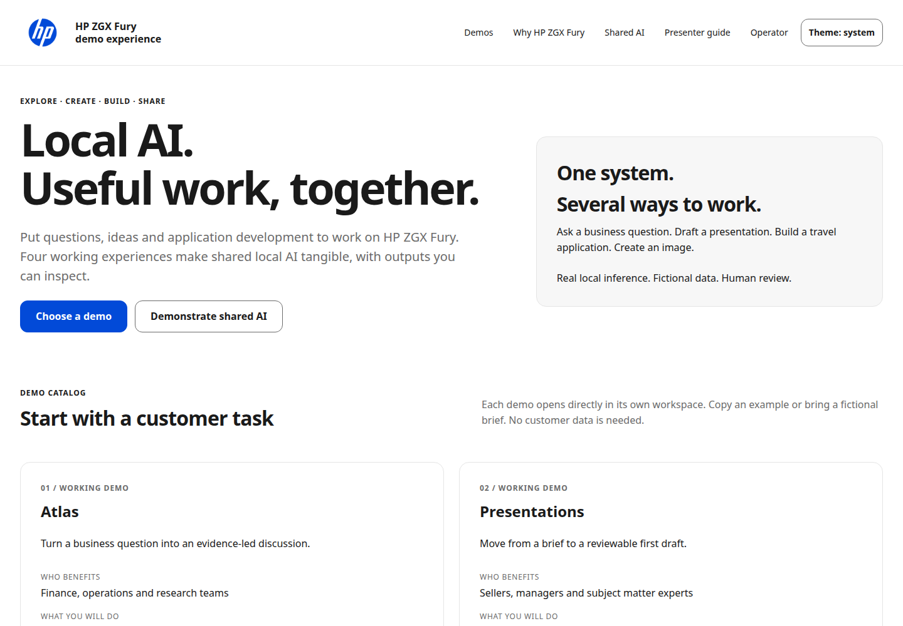

# HP ZGX Fury demo experience

Run Atlas analytics, local presentation creation, an autonomous Agent Factory, image generation, speech, and a measured-token operator dashboard on one GB300. Use it to demonstrate several useful local AI workflows sharing a workstation, with generated applications, real browser previews, isolated Python backends and visible resource limits.

This is a demonstration project, with fictional data and public demonstration accounts. It is not an officially supported or endorsed HP or NVIDIA product. HP and NVIDIA names identify the tested hardware; their trademarks remain their owners' property. Restricted product photography and unapproved logos are excluded; the owner-supplied official HP mark is included under its separate trademark terms.

**Supported/tested host:** Ubuntu 24.04 ARM64, NVIDIA GB300 with **256703 MiB HBM**, 743 GiB system RAM, existing working NVIDIA driver and CUDA toolkit. No Nano, smaller GPU, x86, Windows, or macOS compatibility is claimed. The complete profile requires at least 700 GiB RAM and 350 GiB free disk before setup. See [prerequisites](docs/PREREQUISITES.md) and [verification](docs/VERIFICATION.md).

## Download and launch

```bash
git clone --branch v2.1.0 https://github.com/Navigatedhustle/hp-zgx-fury-showcase.git
cd hp-zgx-fury-showcase
./launch.sh
```

For a release ZIP, extract it, open a terminal in the extracted directory, then run:

```bash
chmod +x launch.sh showcase
./launch.sh
```

Git metadata, GitHub authentication and the publisher's model credentials are not needed. `./launch.sh` checks prerequisites, prepares pinned local environments, downloads and verifies model files, initializes fictional data through the applications, starts components in order, waits for readiness, and opens **http://localhost:8080** when a desktop browser is available. Setup uses public HTTPS package/model sources. It never installs host GPU drivers, changes the kernel, configures networking or enables boot startup.

The pinned model files total **193.91 GiB**; allow another 20–40 GiB for dependencies and caches, plus output growth. First installation depends on network speed and cold kernel compilation. An empty-cache model launch took about 39 minutes on this host; later cached restarts are much shorter. First-use NVIDIA kernel download/compilation needs internet and can take tens of minutes. Progress is printed. Later launches reuse models/environments and recognize this installation's healthy services without duplicate model loads. Occupied ports owned by another installation cause a clear refusal.

```bash
./launch.sh                  # subsequent launch
./launch.sh status
./launch.sh stop             # identity-checked, repeatable shutdown
./launch.sh diagnostics      # local information and recent logs; don't upload unreviewed
./launch.sh recover agent    # guarded individual recovery, only when idle is established
./launch.sh restart agent    # explicit component restart after inspecting active work
./launch.sh setup            # resume/repair dependency or model setup
./launch.sh desktop          # optional application-menu shortcut
```

A desktop copy may require the file manager's **Allow Launching / Trust** action. The shortcut opens a terminal so installation progress and errors remain visible. Setup does not require Git even when launched from a ZIP. Administrator prerequisite installation can be required; it is never performed silently.

## Agent Factory presenter update

Choose Live build for actual local development or Guided demonstration for a clearly labeled recorded successful run with a working application artifact. The main view shows stages, current tasks, evidence, elapsed time and endpoint usage; checked previews remain available until you refresh to a newer version. [Presenter details](docs/AGENT-FACTORY-PRESENTER.md) · [Colorado deployment PDF](docs/Colorado-Deployment-v2.1.0.pdf) · [Release verification](docs/FACTORY-VERIFICATION.md).

## Present the HP experience

The home page has direct demo launches, customer tasks, sample inputs, a shared-AI walkthrough, and sourced HP system/software content. Start with the customer’s task, then show the actual output and evidence. [Presenter guide](docs/PRESENTER.md) · [HP claims](docs/HP-CLAIMS.md) · [Design reference](docs/HP-DESIGN.md) · [V2 verification](docs/V2-VERIFICATION.md).



The shared light-first shell uses the official owner-supplied HP logo with white keyline and local system fonts. Dark adaptation follows the system until a visitor selects a theme. No licensed HP font files or external marketing/font services are required. HP Z Toolkit and HP Z Runtime are explained as available HP capabilities; this demo actually uses its existing vLLM/gateway stack.

## Use the showcase

| Tool | Local address | Try this |
|---|---|---|
| Dashboard | http://localhost:8080 | Open an experience; `/operator` shows measured token usage and resource status. Cost comparisons are estimates. |
| Atlas | http://localhost:8200 | Ask “What happens to Q4 profit if our Commit stage win rate drops by 8 percentage points?” Inspect grounding and export the result. Data is synthetic. |
| Presentations | http://localhost:8765/booth | “Explain reliable local AI workflows, evidence, human review, and next steps.” Generate a three-slide deck, view it, download the PPTX. The full editor is also included. |
| Agent Factory | http://localhost:8501/devteam | Select the short travel build for a freshly generated frontend/backend. Choose automatic review for an uninterrupted demonstration, or approve its explicit gates. Inspect source, tests, backend requests, immutable preview and export. |
| Complete travel product | Same Factory page: complete-travel mode | The maintained frontend is explicitly marked supplied. DeepSeek generates backend modules and QA for accounts, search, favorites, itineraries, quotes, reservations and administration; Qwen handles frontend repairs if needed. See [travel workflow](docs/TRAVEL.md). |
| Image Studio | http://localhost:8800 | “A detailed botanical illustration of a red fox in an autumn garden, natural light, no text.” Generate and download an image. No video model is installed. |

Atlas has CPU English speech recognition and GPU Kokoro speech. Browser microphone permissions require localhost or your own secure remote setup. No physical microphone or speaker is bundled.

To demonstrate **four concurrent workflows**, start an automatic short Factory build, then submit the Atlas question, a booth presentation, and an image while agents are generating. Use four tabs or browser contexts. The gateway admits four inference requests, with one reserved for Atlas; DeepSeek serves one sequence, Qwen four. Factory admits one build globally and at most two development calls. Booth admits three outstanding jobs and authors one at a time; images admit one active plus three queued. The public profile allocates nominally 168 GiB to the DeepSeek engine and 32 GiB to Qwen. The old live deployment used 176 GiB for DeepSeek; reducing its surplus KV allocation preserved its 16K context and single sequence while restoring measured memory headroom after cold initialization. No model, context limit, serving slot or admission limit was replaced. These bounded limits preserve overlap; larger contexts/decks or multiple Factory builds are outside the tested envelope. [Example inputs](examples/inputs.json) are included.

The supplier and Research & Sales implementations are retained as historical source and fictional fixtures only. The current Factory server redirects their old pages to `/devteam` and returns HTTP 410 for retired APIs; no live supplier workflow or draft inbox is claimed.

The [prebuilt reference travel application](examples/reference-travel/README.md) is a separate, labeled example. It is never used to claim that a new build has completed.

## Operation and limitations

All listeners bind loopback. [Optional remote access](docs/REMOTE-ACCESS.md) uses the recipient's own SSH or private network setup; no publisher tailnet identity or credentials are distributed. Local operation needs neither Tailscale nor a cloud model API key.

Generated code can fail validation; failed work stays diagnosable and is not silently replaced with canned output. Complete-travel generation is longer than the short showcase build and can require several repairs; per-ticket and repeated-failure limits can block a run. Never use real passwords, customer records, payments or bookings. This local demonstration is not hardened as an internet-facing service. Historical Atlas vision/embedding/Nano-era code is retained as inactive source, and its models are not required/downloaded by the launch profile.

If setup is interrupted, rerun `./launch.sh setup`; downloads resume through Hugging Face metadata. A checksum failure identifies the file to remove before retrying. For missing GPU/toolchain/Chromium/namespace prerequisites, see [troubleshooting](docs/PREREQUISITES.md). For occupied ports, stop the other installation using its own controller; never kill a process based only on a port. Inspect `logs/COMPONENT.log` and `./launch.sh diagnostics`. To recover a failed component, wait for active work, use guarded recovery, then retry your own job. Back up runtime output before deleting it. There is no automatic reset or infinite restart loop.

[QUICKSTART](QUICKSTART.md) · [Architecture](docs/ARCHITECTURE.md) · [Assets/models](docs/ASSET-MANIFEST.md) · [Verification](docs/VERIFICATION.md) · [Third-party notices](THIRD_PARTY_NOTICES.md) · [MIT source license](LICENSE)

## Upgrade and rollback

The preceding V2 release remains available as v2.0.0. V1 also remains available as v1.0.0 (commit e98c85ee26169a6d745de775feea049ae7a3dc63). Preserve runtime outputs and wait until all users/jobs are idle before switching a release. Never start two model stacks on this GPU.

For a Git checkout with clean tracked source:

```bash
./launch.sh stop
git fetch --tags origin
git switch --detach v2.1.0
./launch.sh
```

To roll back:

```bash
./launch.sh stop
git switch --detach v2.0.0
./launch.sh setup  # restore the preceding V2 release
./launch.sh
```

For archive installs, keep the previous release directory and its own environments/output. Stop the current installation through its own launcher, then launch the previous one. Do not copy process registries between directories. Back up outputs first; this UI release changes no application database schema.

V2.0 predates Guided demonstration. Use a fresh browser profile when presenting a prior release; retained recorded artifacts remain recorded and must not be described as newly generated.
