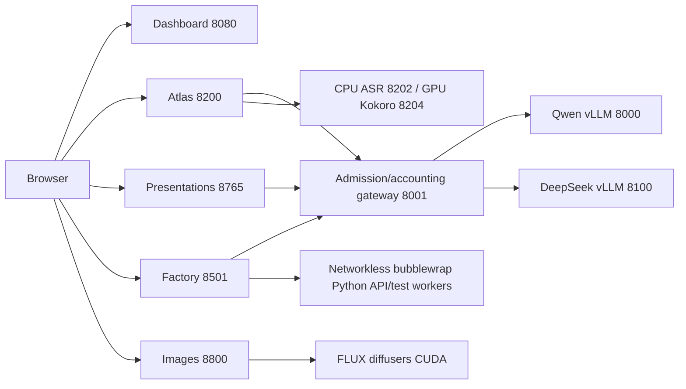

# Architecture

`launch.sh` performs setup/preflight and delegates service ownership to the existing `showcase` → `ops/control.py` controller. No second supervisor is introduced. It records exact Linux process identities under this installation's `state/`, starts detached sessions in dependency order, waits for application readiness/model identity, rejects unknown listeners, rolls back failed newly started components and verifies shutdown. It does not adopt another installation's registry. `config/gb300.json` replaces the private machine-specific runtime plan; GPU selection defaults to index 0 (`FURY_GPU` can select a local index/UUID).

`showcase_app/` supplies the gateway, operator dashboard, shared navigation/styles, image queue and speech recognition. Usage records count upstream request identities once; unavailable usage remains unknown. Estimated external cost comparisons are not actual bills.

`build/sources/atlas-gpt-main/atlas/` generates deterministic synthetic business/university SQLite data and grounds local-model interpretation in its analytics. Developer tooling is scoped to read-only synthetic data. Historical optional vision/embedding/decision engines remain inactive; their alternate models are not downloaded by this distribution.

`build/sources/html_builder-main/backend/` contains the presentation pipeline, booth API, SQLite store, preview rendering and PPTX export. `frontend/` includes editable React/Vite source, package lock and the built editor. `skill/` supplies the actual prompt pack and examples; `runtime/` supplies fonts and neutral illustration assets. SQLite schemas are created by the checked-in store models at startup; no runtime database is bundled. Booth generation validates author JSON before writing artifacts.

`build/sources/fury_agent_factory/` contains the active development team, role definitions/prompts, orchestrators, session/run isolation, durable audit/export state, generated source versions and preview/backend transports. Historical supplier/prospecting code and fixture data remain source-only; the active API explicitly retires those routes with redirects/HTTP 410. The short build generates frontend/backend/QA. The complete-travel build installs the maintained portal as explicitly supplied frontend, then local agents implement backend modules and tests. It never substitutes the reference application for a failed generation. Per-run SQLite is the only writable generated-application persistence. Generated code executes with no network and explicit resource limits in bubblewrap; the browser sees an opaque iframe connected by a validated message bridge.

Model engines load once per installation. Qwen serves four sequences at 65536 maximum engine context (development tasks capped at 32768); DeepSeek serves one at 16384. Exact fractions, prefill/context limits and model revisions are checked in. The public GB300 profile uses DeepSeek fraction 0.6701596786948341 (nominal 168 GiB), Qwen fraction 0.12764946260853982 (nominal 32 GiB). This reduces surplus lead KV memory from the original 176 GiB engine plan, preserving its 16384 context and single physical serving slot. The gateway admits four upstream calls, at most three ordinary calls, reserving one for Atlas. These constraints must be retained when changing models or workload sizes.

Runtime data lives in `state/`, component `data/`, `artifacts/`, `runs/`, `devruns/` and `devruns-archive/`. Environments, tools, downloaded weights, browser profiles, logs and caches are local-only and ignored. Demonstration seed JSON is explicitly included only for fictional suppliers/documents; other seed/schema definitions are source code. The publication manifest selects individual redistributable files; release packaging never archives the working directory wholesale.

## Presenter and recording layer

Agent Factory retains its existing workers, models, sandbox and gateway. The presenter view summarizes real tasks/checks. Compact SSE carries job/sequence/time snapshots; detailed file evidence is fetched on demand. Checked travel frames and backend calls accept the same explicit version, preventing an open visitor session from silently moving to new code. GuidedRun reuses only the isolated travel application transport and per-run data. Its curated recording is checksum-bound, contains no private runtime data, issues no model requests, and is recovered as recorded mode after restart.

## Conference station layer (v2.2)

The existing operator process serves `/stations`, `/demos`, `/operator`, `/why-hp`, and `/presenter`. Browser-local assignment and retained application frames provide independent screen control. The frame policy permits only the same site's chooser origin (loopback port 8080 or the current validated Tailscale hostname), while generated frames retain network/form restrictions and their existing sandbox. No Tailscale permissions, serving model settings, queues, worker lifetimes or process ownership rules change.

`showcase_app/event.py` runs one five-second collector in the operator lifespan. It reuses the gateway ledger and health collection, persists aggregate session samples in additive `state/event-session.sqlite`, and serves cached `/api/live` plus aggregate-only `/api/event`. Energy integrates measured readings with gaps excluded; cached official prices live in `config/event-pricing.json`. Presenter reset changes only the measurement window and requires host-shell authority or an external private presenter key. No second supervisor, external inference API, or telemetry daemon is added.
