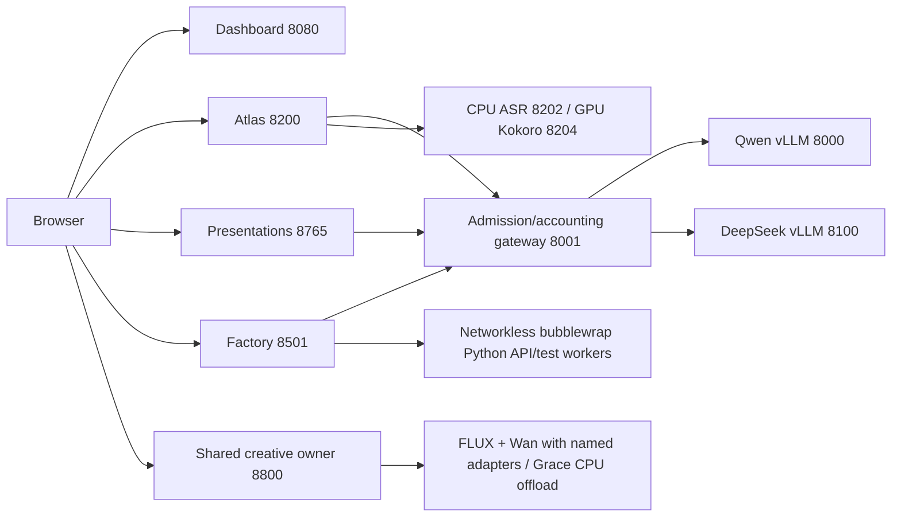

# Architecture

`launch.sh` performs setup/preflight and delegates service ownership to the existing `showcase` → `ops/control.py` controller. No second supervisor is introduced. It records exact Linux process identities under this installation's `state/`, starts detached sessions in dependency order, waits for application readiness/model identity, rejects unknown listeners, rolls back failed newly started components and verifies shutdown. It does not adopt another installation's registry. `config/gb300.json` replaces the private machine-specific runtime plan; GPU selection defaults to index 0 (`FURY_GPU` can select a local index/UUID).

`showcase_app/` supplies the gateway, operator dashboard, shared navigation/styles, image queue and speech recognition. Usage records count upstream request identities once; unavailable usage remains unknown. Estimated external cost comparisons are not actual bills.

`build/sources/atlas-gpt-main/atlas/` generates deterministic synthetic business/university SQLite data and grounds local-model interpretation in its analytics. Developer tooling is scoped to read-only synthetic data. Historical optional vision/embedding/decision engines remain inactive; their alternate models are not downloaded by this distribution.

`build/sources/html_builder-main/backend/` contains the presentation pipeline, booth API, SQLite store, preview rendering and PPTX export. `frontend/` includes editable React/Vite source, package lock and the built editor. `skill/` supplies the actual prompt pack and examples; `runtime/` supplies fonts and neutral illustration assets. SQLite schemas are created by the checked-in store models at startup; no runtime database is bundled. Booth generation validates author JSON before writing artifacts.

`build/sources/fury_agent_factory/` contains the active development team, role definitions/prompts, orchestrators, session/run isolation, durable audit/export state, generated source versions and preview/backend transports. Historical supplier/prospecting code and fixture data remain source-only; the active API explicitly retires those routes with redirects/HTTP 410. The short build generates frontend/backend/QA. The complete-travel build installs the maintained portal as explicitly supplied frontend, then local agents implement backend modules and tests. It never substitutes the reference application for a failed generation. Per-run SQLite is the only writable generated-application persistence. Generated code executes with no network and explicit resource limits in bubblewrap; the browser sees an opaque iframe connected by a validated message bridge.

Model engines load once per installation. Qwen serves four sequences at 65536 maximum engine context (development tasks capped at 32768); DeepSeek serves one at 16384. Exact fractions, prefill/context limits and model revisions are checked in. The public GB300 profile uses DeepSeek fraction 0.6701596786948341 (nominal 168 GiB), Qwen fraction 0.12764946260853982 (nominal 32 GiB). This reduces surplus lead KV memory from the original 176 GiB engine plan, preserving its 16384 context and single physical serving slot. The gateway admits four upstream calls, at most three ordinary calls, reserving one for Atlas. These constraints must be retained when changing models or workload sizes.

Runtime data lives in `state/`, component `data/`, `artifacts/`, `runs/`, `devruns/` and `devruns-archive/`. Environments, tools, downloaded weights, browser profiles, logs and caches are local-only and ignored. Demonstration seed JSON is explicitly included only for fictional suppliers/documents; other seed/schema definitions are source code. The publication manifest selects individual redistributable files; release packaging never archives the working directory wholesale.

## Presenter and recording layer

Agent Factory retains its existing workers, models, sandbox and gateway. The presenter view summarizes real tasks/checks. Compact SSE carries job/sequence/time snapshots; detailed file evidence is fetched on demand. Checked travel frames and backend calls accept the same explicit version, preventing an open visitor session from silently moving to new code. GuidedRun reuses only the isolated travel application transport and per-run data. Its curated recording is checksum-bound, contains no private runtime data, issues no model requests, and is recovered as recorded mode after restart.

## Conference station layer (v2.2)

The existing operator process serves `/stations`, `/demos`, `/operator`, `/why-hp`, and `/presenter`. Browser-local assignment and retained application frames provide independent screen control. The frame policy permits only the same site's chooser origin (loopback port 8080 or the current validated Tailscale hostname), while generated frames retain network/form restrictions and their existing sandbox. No Tailscale permissions, serving model settings, queues, worker lifetimes or process ownership rules change.

`showcase_app/event.py` runs one two-second collector in the operator lifespan. It reuses the gateway ledger and health collection, persists aggregate session samples in additive `state/event-session.sqlite`, and serves cached `/api/live` plus aggregate-only `/api/event`. Energy integrates measured readings with gaps excluded; cached official prices live in `config/event-pricing.json`. Presenter reset changes only the measurement window and requires host-shell authority or an external private presenter key. No second supervisor, external inference API, or telemetry daemon is added.

## Enterprise visual review and voice rendering (v2.3)

New short runs pin a disclosed public hero image under their private run root. The coordinator and independent browser validator supply that same checksummed data URI and CSS variable, with no network permission. Existing runs without that asset retain their original environment. Models author the frontend; artwork is supplied and excluded from live image/token claims. A bounded frontend-only Visual acceptance ticket uses exact edits, real generated-backend requests, local axe-core and desktop/mobile layout checks on empty/populated reservation states before final release. Earlier checked versions remain immutable and usable during a failed candidate or repair. Serving models, gateway admission, Atlas reserve and two development request slots are unchanged.

Atlas's original Canvas/Web Audio orb retains actual local audio routing and analyser input. Its renderer coalesces animation frames, scales down idle rendering, and suspends for hidden workspaces, paused audio and reduced motion. Audio-driven deformation is separate from model performance accounting; it never represents extra inference or simulated token activity.

## V3 Mission Control and local experiences

The existing operator process owns the new Vision/Translate/Trailer orchestration and the Mission Control pages. `telemetry.py` reads native GPU process memory, power, temperature, CPU/disk and physical Grace NUMA node 0 separately from Linux's aggregate Grace/HBM memory. It derives engine output throughput from native vLLM generation-token counter differences. `event.py` serializes one cached snapshot every two seconds and uses Condition-based SSE fanout. `chrome.py` proxies the same stream on component origins without changing frame policy. Hidden frames suspend expensive rendering; the parent forwards telemetry only to visible workspaces. No second supervisor or model engine is added.

`workloads.py` bounds orchestration to four active and sixteen outstanding jobs. Vision uses the existing Qwen multimodal engine, then requests a grounded executive brief. Translation parses text PDFs/DOCX/TXT and submits up to four page calls through unchanged gateway admission. Structured output requires one translation per extracted nonempty line and validates numeric/product-code coverage. Output-length termination fails the job. PDF/DOCX/TXT downloads use clean reflow; DeepSeek's terminology review is advisory. Fictional samples are rendered from included text/SVG sources. Documents live outside the repository under the user's `.cache/fury-showcase/documents`.

The gateway's short-request routes record requested model, actual model and routing reason. If DeepSeek is active or waiting, short lead requests immediately use Qwen with a visible explanation, including the Factory-specific busy reason. Loopback destinations are enforced. The external request counter covers recorded inference destinations, not all host traffic. Gateway total/normal/Atlas/DeepSeek admission and engine settings remain unchanged.

`creative.py` owns FLUX and Wan in one service process and one GPU lane. The image and text video pipelines share the exact same component objects/weights. Idle modules remain CPU-resident on physical Grace; per-thread CPU allocation is bound to node 0. Compatible Apache-2.0 LongLive-Plug adapters are checksum-checked and CPU-fused once before offload. The worker's process allocator budget leaves the 10 GiB reserve and an additional guard. Jobs are sequential, including image batches; one active plus three queued jobs remain the bound. Models are named in every job and health response.

Action Trailer uses `visitor_store.py` for memory-only consent and 0700 per-session directories outside the repository. Only the consented camera flow accepts visitor photos. Cookie-scoped media and jobs require that session; private creative jobs additionally require an external service key. `trailer.py` creates a bounded original PG screenplay, neutral visible continuity, reference FLUX keyframes, sequential Wan clips and pinned Kokoro am_michael narration. `trailer_render.py` creates an original oscillator soundtrack, title cards and watermark with local FFmpeg. A slow run visibly cuts to two shots. Done/New/deletion/15-minute idle/service startup removes visitor files and cancels owned work; polling does not touch retention. A deleted directory is never recreated by a worker. The browser receives private previews; final download requires localhost host and client.

Mission Control retains original Atlas/Slides/Factory controls and workflows. Fury Rush messages each owned iframe, deduplicates request IDs and invokes those original controls. It reports queued/submitted/complete/failed honestly. The Factory worker prompts, sandbox, models and two-proposal limit are frozen apart from the owner-authorized Visual diagnostic/compiler repair. Its real screenshot comparison detects supplied artwork hidden by an opaque overlay, while allowing useful translucent gradients and restoring exact source styles. Existing generated versions remain immutable.
