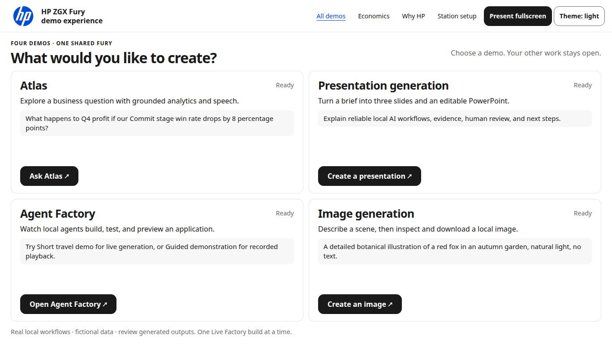

# Conference UI verification — v2.2.0

Verified 4–5 November 2026 on the existing Ubuntu ARM64 / NVIDIA GB300 Fury. Tests used independent Chromium contexts on that Fury, with actual local HTTP and existing private HTTPS/WSS routes. This is not a claim of testing physically separate laptops, a fresh Colorado installation, or physical microphone/speaker quality. The sanitized machine-readable results are [conference-verification.json](conference-verification.json); raw owner sessions, run IDs, hostnames and receipts remain private.

## Result and coverage

| Check | Result |
|---|---|
| Full source regression suite | 161 Factory + 34 core tests passed; core includes 15 event/accounting/framing fixtures |
| Layouts at 100% browser zoom | 72 cases passed across 1366×768, 1280×720, 1440×900, 1920×1080, 1366×640 and 1280×620 CSS content viewports |
| Final retained real outputs | 16 local output layouts at the four primary viewports + 4 through private HTTPS passed |
| Station independence | Separate contexts retained Economics / Why HP roles while two interactive contexts selected, returned and refreshed independently |
| Passive displays | No inference ledger additions during the dedicated 20-second passive check; one shared five-second collector |
| Reset | Unauthorized request rejected; authorized reset preserved source ledger, jobs and artifacts; station reset is browser-local |
| Accessibility | axe 4.11.0: 48 desktop/mobile/light/dark states, zero reported WCAG A/AA violations and zero browser exceptions; not complete conformance certification |
| Final cost chart | 12 light/dark viewport states; distinct matching legend/plot patterns, model selection and a final dark accessibility audit passed |
| Optional fullscreen | Native entry/exit passed after awaiting browser events |
| Streaming / retention | Real grounded Atlas response finished while its workspace was hidden; Guided continued across chooser navigation and reconnected after refresh |
| Private routes | Actual HTTPS station pages and all four mounted demos passed; no Serve or access-policy changes |
| Downloads | Actual image PNG decoded at 768×768; editable PPTX ZIP validated with three slides; Atlas PNG decoded and PDF signature validated, locally and over private HTTPS |
| Factory application | Original retained Live build: real preview, booking, persistence, duplicate rejection, city filtering, price sorting, navigation, workspace tabs, backend and JSON export passed; another browser could not cancel it |
| Voice | Local real TTS/ASR passed. Actual microphone control over private HTTPS/WSS passed with a synthetic Kokoro WAV injected as Chromium's test microphone |
| Preservation | All 61 original generated-version files matched their pre-upgrade backup; serving config, model pins/files, gateway/controller and resident model/gateway process identities unchanged |

Primary input/status/output controls fit the initial laptop viewport. Long generated content, code and evidence use contained scrolling. Browser chrome and OS scaling reduce the available CSS content viewport; the two shorter viewports cover that case without zoom or scale transforms. Automated checks supplement visual inspection and keyboard access; they do not establish every possible browser/device combination.

## Actual concurrent generation

One real Live short build ran while Atlas, presentation and image requests executed, with independent Economics and Why HP displays open. Three measured four-component execution overlaps lasted 0.333, 0.226 and 0.911 seconds. This is execution evidence, not an animation or submission-time inference.

| Workflow | Observed time |
|---|---:|
| Atlas requested response | 2.196 seconds |
| Three-slide presentation | 9.546 seconds |
| Image | 8.194 seconds |
| Factory generated build | 308.861 seconds, 15 model calls; its own checks passed |

The original hardware/browser harness exited unsuccessfully: after the generated build finished, the expanded Advanced controls panel intercepted the final preview-refresh click. The panel was changed to expand in flow and close when Start is pressed. The **same retained generated run** then passed application/backend/browser/persistence rechecks. No second Live build or fresh four-workflow cycle is claimed after that fix, and the original failed receipt remains preserved.

The Economics output totals and each API scenario matched the physical-request ledger. Recorded activity was excluded. Passive screen URLs remained unchanged. The operator used 2.34 CPU seconds over 348.20 wall seconds with both displays open. Minimum sampled free HBM was 30,511 MiB. These samples support the observed operating envelope; there was no controlled before/after latency experiment and no claim that passive displays have zero performance cost.

## Earlier failures and corrected verification

The first layout harness completed all 72 passing geometry cases, then failed an import in its reset assertion. The corrected focused station suite passed all four independent-assignment, navigation, passive-no-inference and authorization checks. A hidden-frame wait initially relied on requestAnimationFrame and timed out when the browser paused rendering; explicit polling verified the continuing real response. A fullscreen assertion raced the browser event; the independent awaited test passed.

The first accessibility attempt found a real keyboard-focus issue in the progress region, corrected with a focusable named region. Its harness also attempted localStorage in opaque sandbox frames; the guarded harness then completed the 48 passing states. During final retained-output verification, the harness expected an obsolete nested preview frame and injected sessionStorage into sandbox frames. Those test assumptions were corrected without changing the generated application or sandbox; the final 20 output-layout cases passed. Earlier receipts were retained, not overwritten as successful tests.

## Before and after

At 1366×768, the previous chooser document was 4,571px tall; the previous Economics page was 3,680px tall. The new chooser and stationary screens fit the content viewport. The old whole-page capture below shows the previous document's length, not a different browser zoom.

[Before: complete chooser document](screenshots/conference/chooser-before-1366x768.png) · [After: chooser](screenshots/conference/chooser-after-1366x768.png) · [After: Economics](screenshots/conference/economics-after-1366x768.png) · [After: Why HP](screenshots/conference/why-hp-after-1366x768.png)

## Measurement and deployment limits

This host measures **GPU-only energy**, integrated between actual readings with gaps excluded. Idle energy within the event window is included. A whole-system meter input has parsing/freshness/scope fixture coverage, but no wall-meter hardware was tested. The default USD 0.25/kWh tariff is a configurable planning assumption. Electricity excludes hardware, cooling beyond meter scope, staffing and ownership costs; no ROI or break-even claim is made.

API comparisons use locally cached official text input/output prices checked 4 November, documented in [CONFERENCE.md](CONFERENCE.md) and [event-pricing.json](../config/event-pricing.json). They are pricing scenarios for observed token volumes, not bills or equal model-quality/latency guarantees. No paid external calls populate the display. Recorded playback does not create live token activity.

The deployment guide and explicit release inclusion/checksum policy are updated. Previous tags/releases and private runtime data are preserved. Earlier four-cycle soak and installation results in [FACTORY-VERIFICATION.md](FACTORY-VERIFICATION.md) remain historical and were not repeated by this UI release. Rollback requires idle jobs and backed-up outputs; use the v2.1.1 sequence in [CONFERENCE.md](CONFERENCE.md).
