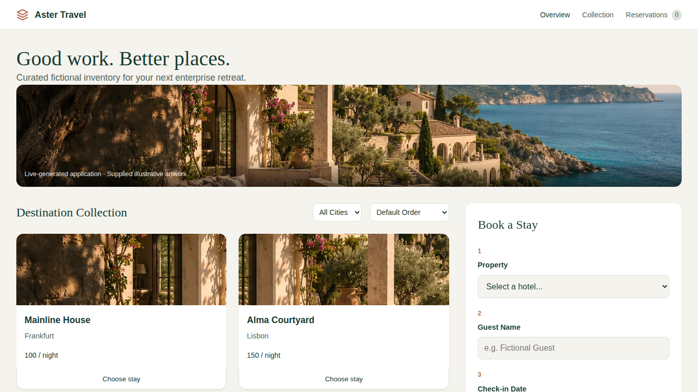

# Enterprise visual and voice verification — v2.3.0

Verified 5 November 2026 on the existing Ubuntu ARM64 / NVIDIA GB300 Fury. [Sanitized result summary](enterprise-verification.json). This release improves the actual application generated by Factory, the explicitly supplied complete/Guided travel interface, and Atlas's voice visualization. Existing generated applications are preserved. All data and imagery depict fictional demonstrations.

## What changed

New short builds author a premium travel interface with editorial typography, warm neutral surfaces, forest-green controls, rich imagery, real inventory, filtering, booking and persistent reservations. A supplied fictional hero is clearly labeled and pinned per new run with a checksum. The same data URI and CSS variable are available in the production preview and independent browser validation; they never enter model context or grant network access. Short application code and original SVG details are generated live. Complete travel still discloses its supplied frontend; Guided still discloses its recorded run and unchanged recorded backend/usage.

A final Visual acceptance task reviews the actual frontend after contract review. It receives real precheck failures, applies bounded exact edits only to HTML/CSS/JavaScript, and runs desktop/mobile accessibility and overflow checks in empty and populated reservation states. Booking, duplicate rejection, persistence, filtering, sorting and navigation remain required. A rejected candidate does not reach Ready or replace the preceding checked preview. A passing review may retain working source without inventing changes. Focus product now expands the application while retaining a compact progress/token strip; switching focus/tabs preserves the preview version.

Atlas's original Canvas sphere now becomes prominent while speaking or listening. Its deformation follows actual Web Audio samples from local speech/microphone input. It uses a single scheduled animation loop, lower idle frame frequency, pause/hidden-workspace suspension and reduced-motion handling. The orb supports pointer hold, Space and Enter. Audio routing, grounded answers, typed input, playback controls and export remain intact. No animation represents extra inference or model token activity.

## Functional and browser evidence

| Check | Verified result |
|---|---|
| Full source suite | 169 Factory + 34 core tests passed |
| Supplied travel backend | Six real isolated API groups passed |
| Guided travel app | Two full 13-check portal runs passed; final artifact covered accounts, isolation, quotes, reservations, saved stays, itinerary editing, admin, persistence and mobile navigation |
| Final generated short app | Finished using actual local model calls; its own backend/QA and independent booking/conflict/persistence/filter/sort/navigation checks passed |
| Persistent visual gate | Actual precheck/repair and final empty/populated browser checks passed; final retained source also passed an independent rerun with the final validator |
| Final generated layout | 1366×768, 1280×720, 1440×900, 1920×1080 and 375×812 CSS viewports; no horizontal overflow and zero reported axe A/AA violations |
| Supplied app accessibility | 18 discovery/auth/detail states across desktop/mobile and local/private HTTPS; zero reported axe A/AA violations |
| Factory shell/focus | Ten normal/focused states across the four desktop sizes plus private HTTPS; essential controls remained visible and preview URL stayed pinned across focus and tabs |
| Atlas speech orb | Actual local TTS/analyser energy, visible animation, pause/resume, return to idle, reduced motion, and hidden-workspace stop/resume passed locally and through private HTTPS |
| Atlas laptop fit | Six content viewports locally and six through private HTTPS, including 1366×640 and 1280×620; question, hold-to-talk and replay controls stayed visible |
| Orb microphone | Actual private HTTPS/WSS, Enter-key hold on the orb, synthetic WAV microphone, real ASR, grounded answer and real speech energy passed |
| Preservation | All 247 original generated-version files hash-matched their pre-change snapshot; model pins/files, serving/gateway/controller sources and resident model processes were preserved |

Tests used independent Chromium contexts on this Fury at 100% browser zoom. They do not establish physically separate laptop/network/audio-device quality. Automated accessibility checks supplement visual inspection and do not certify complete WCAG conformance. Long generated content scrolls within its application; no CSS scale or browser zoom is used.

## Real four-workflow concurrency

One final real Live build ran alongside Atlas, presentation and image generation while separate Economics and Why HP displays remained open. All four browser workflows passed, and two measured four-component execution overlaps lasted 0.387 and 0.334 seconds. The final generated build completed in 423.840 seconds with 18 physical model calls, including actual rejected/repaired candidates. Observed requested-response times were Atlas 0.944s, presentations 6.702s and image 1.183s; these are measurements for this cached test case, not universal latency claims.

Economics totals and API pricing scenarios matched the physical-request ledger. Passive display URLs remained unchanged. Operator CPU consumption was 3.22 seconds over 438.48 wall seconds with both passive screens open. There was no controlled before/after latency experiment. No serving model, context limit, concurrency setting, Atlas reserve, access policy or network configuration was changed.

## Failures retained and repairs verified

Two preliminary generated builds passed their functional checks. A subsequent visual audit identified mobile horizontal overflow and invalid ARIA in an empty reservations view. These were not treated as acceptable enterprise output; the final persistent visual gate covers those states.

The first gated build safely stopped after an invalid model exact edit and a no-op handling defect in the review helper. The helper now ignores harmless no-op entries, allows truthful no-change reviews, and supplies real precheck feedback. The successful final concurrent run exercised an actual visual repair before Ready. Earlier failed receipts and checked application versions remain preserved privately.

Regression testing also exposed an existing browser-check race: a random fictional guest identifier containing `409` could satisfy a broad text matcher before the duplicate response arrived. The validator now waits for the actual backend reply and matches feedback as words; a deterministic browser regression covers that identifier. Independent backend assertions were preserved.

An initial supplied-app audit found one low-contrast journal paragraph; its color was corrected and all 18 final states passed. The audit harness initially hit Atlas’s inline-script CSP restriction; the auditor was installed through standard automation evaluation while production CSP and generated-code isolation remained intact.

## Images and operation

[Before: previous generated app](screenshots/enterprise/generated-before.png) · [Final generated app](screenshots/enterprise/generated-1366x768.png) · [Supplied Guided app](screenshots/enterprise/guided-travel-1366x768.png) · [Focused Factory](screenshots/enterprise/factory-focused-1366x768.png) · [Atlas speaking](screenshots/enterprise/atlas-speaking-1366x768.png)

The new hero was created once for this project using the built-in imagegen tool and optimized for local delivery; it is not generated during a visitor's build. Its exact prompt and origin are in [artwork provenance](../build/sources/fury_agent_factory/travel_portal/assets/PROVENANCE.md). The six destination illustrations are original local SVG compositions. Unmodified axe-core 4.11.0 and its MPL 2.0 license are included for independent local browser validation.

Refresh Atlas to load the new orb. Start a new Factory build to use the new generated design, or a new Guided run to use the refreshed supplied artifact. Existing generated applications keep their original files. The previous v2.2.0 release remains available; wait for idle jobs and back up runtime outputs before rollback. No new model boot, fresh host installation, physical audio acceptance, production security certification or paid external inference by the demo runtime is claimed. The existing fictional-data and prototype operating limits remain applicable.
