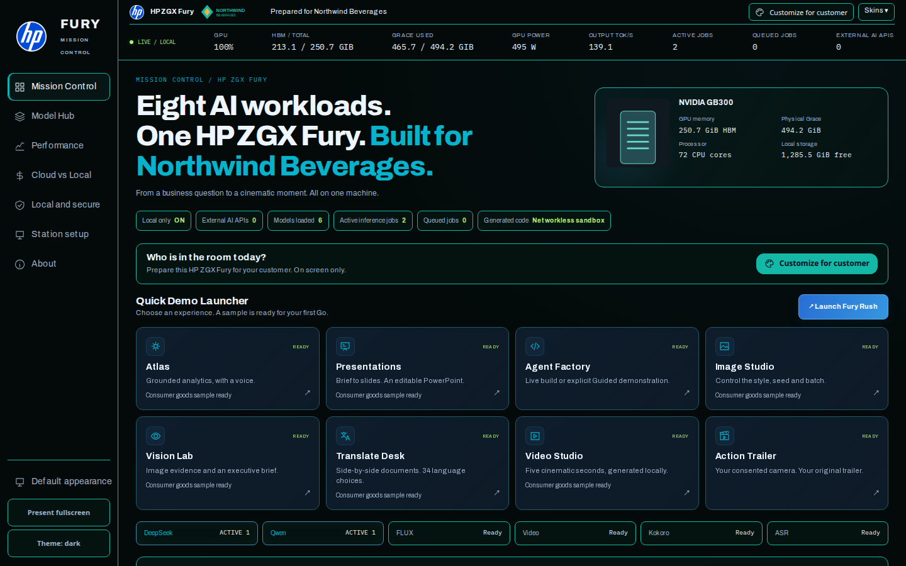
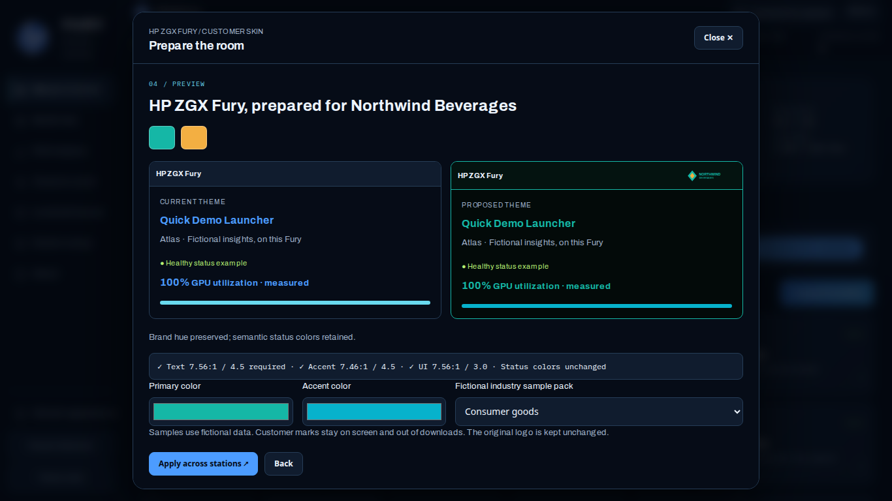

# HP ZGX Fury: fresh installation and demo guide

**v3.1.0 · Customers and partners · November 2026**

This is community demonstration software for the tested HP ZGX Fury GB300 configuration. It uses fictional business data and is provided **as is under the repository’s MIT license**. It is not a supported or endorsed HP product. HP, NVIDIA and model publishers retain their respective marks and licenses.

## 1. What runs on this workstation

Eight experiences share the same local model services. Model inference, speech, document processing and visitor media generation run on the Fury. Setup needs outbound internet access. Optional Customer Skin research fetches public information; it is distinct from external model inference.

| Experience | A useful first demonstration |
|---|---|
| Atlas | Ask an executive question about the synthetic business, inspect grounding, then hear the answer. Its developer tools explicitly run generated Python or SQL inside an isolated read-only synthetic-data workflow. |
| Presentations | Enter a brief, generate three slides and download editable PowerPoint. The full editor remains available. |
| Agent Factory | Start a short automatic Live build and inspect actual development, tests and functional preview. Guided mode is labeled recorded playback. |
| Image Studio | Select style, ratio, seed and batch size; generate an original image, download it or send it to Video Studio. |
| Vision Lab | Choose a fictional chart, document, whiteboard, scene or defect sample; inspect extraction and an executive brief. |
| Translate Desk | Translate the included text document into a chosen language; inspect pages and download PDF, DOCX or TXT. |
| Video Studio | Generate a five-second text-to-video or image-to-video clip through the shared creative lane. |
| Action Trailer | Read consent, capture a camera image, generate an original PG trailer, play it, then delete the session. |

Translation uses clean text reflow, not preservation of the source document layout. Scanned PDFs need OCR and are rejected. Language quality and model-generated facts require human review. Video uses the disclosed five-second preset. A trailer may visibly use the disclosed two-shot fallback when its time budget is exceeded.



*Illustrative V3 screenshot. Northwind Beverages and its artwork are fictional. Hardware readings show the captured session, not a promised capacity or throughput.*

## 2. Requirements and disk planning

Use the existing working operating system, GPU driver and CUDA toolkit approved by your workstation administrator. This installer does not replace them or change the kernel, firewall, network access policy or boot services.

| Item | Tested configuration or installation requirement |
|---|---|
| Platform | Ubuntu 24.04 ARM64, Python 3.12, one NVIDIA GB300. Other platforms and smaller GPUs are unverified. |
| GPU memory | 256703 MiB HBM on the tested host. Keep the configured 10 GiB reserve and existing model/concurrency budgets. |
| Physical CPU memory | 494.15 GiB usable Grace memory; preflight requires at least 480 GiB. Linux’s approximately 743.65 GiB aggregate includes GPU memory and is not the physical Grace capacity. |
| Driver and toolkit | Tested existing driver 595.99.02 and CUDA compilation toolkit 13.3.33. Your administrator must assess any different combination. |
| Free disk | Start with at least 350 GiB free. Pinned model files total approximately 227.566 GiB. Environments, browsers, compiler caches and generated output require additional space. The fresh candidate checkout, tools, environments and caches measured 14.775 GiB excluding shared weights; allow approximately 242.4 GiB combined plus operating headroom and growing outputs. |
| Ordinary system tools | curl, CA certificates, tar/xz, unzip for ZIP installation, gcc/g++, make, bubblewrap, util-linux, apt-get/dpkg-deb, libsndfile1 and libnuma. A working `/usr/local/cuda/bin/nvcc` is required. |
| Browser | Current Chromium or Firefox with JavaScript enabled. Use the real CSS viewport at 100% zoom. Camera/microphone access needs localhost or your approved private HTTPS origin and the browser’s permission. |

Preflight exercises an actual networkless bubblewrap namespace. If site policy blocks it, ask the administrator for scoped support. Do not disable host security controls or bypass the sandbox. The supported launcher fails closed.

Setup needs HTTPS access to GitHub and its release assets, the Python package index and wheel hosts, PyTorch’s wheel index, Hugging Face and its artifact/CDN hosts, Node.js, the npm registry, Playwright’s browser download hosts, your configured Ubuntu package repository, and NVIDIA kernel artifact hosts including `edge.urm.nvidia.com`. First-use GPU compilation can retrieve publisher kernel artifacts. No model API subscription is required for the pinned public models. Optional Customer Skin public research also needs Wikidata/Wikipedia and vetted public logo sources. Offline logo upload does not need that research access.

See [tested prerequisites](https://github.com/Navigatedhustle/hp-zgx-fury-showcase/blob/v3.1.0/docs/PREREQUISITES.md) for administrator details.

## 3. Download a release

Choose a new directory owned by the account that will run the demo. Never start two model stacks on the same GPU.

**Using Git:**

```bash
git clone --branch v3.1.0 \
  https://github.com/Navigatedhustle/hp-zgx-fury-showcase.git
cd hp-zgx-fury-showcase
```

**Using the release ZIP:** download the ZIP and its published checksum list from the [v3.1.0 release](https://github.com/Navigatedhustle/hp-zgx-fury-showcase/releases/tag/v3.1.0).

```bash
release=https://github.com/Navigatedhustle/hp-zgx-fury-showcase/releases/download/v3.1.0
curl -fLO "$release/hp-zgx-fury-showcase-v3.1.0.zip"
curl -fLO "$release/SHA256SUMS"
sha256sum --check --ignore-missing SHA256SUMS
unzip hp-zgx-fury-showcase-v3.1.0.zip
cd hp-zgx-fury-showcase-v3.1.0
chmod +x launch.sh showcase
```

Require an `OK` checksum result for the ZIP before extracting it. The separately published `SOURCE-SHA256SUMS` authenticates the listed source files inside the extracted release. You can check them from the extracted directory:

```bash
sha256sum --check SOURCE-SHA256SUMS
python3 ops/check-source.py
```

## 4. Install and launch

Run the pinned setup and keep the terminal visible:

```bash
./launch.sh setup
./launch.sh
```

Setup creates three local Python environments, installs locked packages, builds the editor, downloads immutable model revisions and verifies every model file’s size and SHA256. The first launch loads both language models, speech and the shared creative process. Wait for the terminal to report dashboard readiness. Detailed progress is in private `logs/` files.

**Reusing complete weights:** in a fresh checkout with no `models/` entry, the supported option below links an existing model directory you own. It verifies every pinned checksum without modifying or downloading shared weights. Missing, corrupt or mismatched files stop setup; an existing different `models/` directory is never replaced.

```bash
FURY_MODELS_DIR=/absolute/path/to/verified/models ./launch.sh setup
./launch.sh
```

Keep that shared directory available for subsequent launches. The variable is a setup option; the resulting local link persists. Stop the original installation before launching this one. Reusing weights does not prove an empty-cache download or an alternative hardware configuration.

| Measurement on the tested Fury | Observed time and conditions |
|---|---|
| Model bytes reverified | 41 seconds for all pinned files already present, using SHA256. This is a verification measurement, not a full network download. |
| Patched Qwen first start | 216.106 seconds, including new vLLM 0.32 kernel compilation on this host. |
| Complete cold start | 1655.133 seconds (about 27.59 minutes) from first component start to final service readiness, existing weights and new serving-runtime compilation; no reboot or full weight download. |
| Download/setup | 84.141 seconds for fresh candidate tools/dependency/browser downloads, new environments, editor build and verified reuse of existing weights. Complete uncached 227.566 GiB model transfer was not benchmarked; time depends on the connection. |

Network speed, existing caches and first-use compiler work strongly affect setup. Allow tens of minutes for a new compiler cache. The lead readiness deadline is 60 minutes; do not restart an actively compiling verified process merely because its terminal says “waiting for readiness”. Warm-cache restarts are a separate measurement.

Open **http://localhost:8080** on the Fury. If it does not open automatically, paste that address into your browser. Run `./launch.sh status` to inspect readiness and `./launch.sh diagnostics` for local operational details. Review diagnostics before sharing them because they contain installation paths and process information.

## 5. Local and private remote access

The application and model HTTP listeners bind to loopback. The intended access boundary is the workstation account and your organization’s approved SSH or private network policy. Presenter controls intentionally have no PIN. Never expose this demonstration directly to the public internet or use public Funnel hosting.

For a browser on another machine, use your own approved SSH account and host:

```bash
ssh -N -o ExitOnForwardFailure=yes \
  -L 8080:127.0.0.1:8080 -L 8200:127.0.0.1:8200 \
  -L 8501:127.0.0.1:8501 -L 8765:127.0.0.1:8765 \
  -L 8800:127.0.0.1:8800 YOUR_USER@YOUR_HOST
```

Open **http://localhost:8080** on the browser machine while the tunnel is active. Do not forward model ports. Localhost also provides the secure browser context needed for voice and camera permissions.

Alternatively, your administrator can configure the organization’s own private Tailscale Serve routes for the dashboard and four app ports. Keep network authentication and device approvals under that organization’s control. The launcher reads matching existing demo proxy hostnames for its exact Host/Origin allowlist. For another approved private HTTPS proxy, provide its exact hostname explicitly:

```bash
FURY_SERVE_HOSTNAMES=demo.private.example ./launch.sh
```

Replace the example with the actual approved hostname; do not use a wildcard. Browser device permissions and remote camera/audio quality still need validation at the destination. This guide does not grant network access or enroll devices. [Private access details](https://github.com/Navigatedhustle/hp-zgx-fury-showcase/blob/v3.1.0/docs/REMOTE-ACCESS.md).

## 6. Run a demo

At **Station setup**, assign each browser to an interactive demo, Economics, Why HP or Presenter view. The assignment belongs to that browser profile; assigning one station does not change the others. Reopening Home restores its assignment. **Clear this browser’s assignment** resets only that browser’s choice.

Use a Quick Demo Launcher tile to open a retained workspace. Return to Mission Control to switch experiences. Use **Present fullscreen** when useful; Escape exits. The supported main conference viewports are 1280×720, 1366×768, 1440×900 and 1920×1080. Smaller content areas use contained scrolling.

For simultaneous work, press **Launch Fury Rush** once. It submits six real workflows through the original controls: Factory, Atlas, Presentations, Vision, Translate and Image Studio. Watch each state rather than repeatedly pressing Go. Queues are intentionally bounded; a full lane returns a readable busy state. Four gateway slots include one reserved for Atlas, and creative work shares one active GPU slot.

For **Customer Skin**, choose **Customize for customer**. Enter a name and either research public identity candidates or choose **Use a logo offline**. Upload a permitted PNG/SVG under 2 MB, inspect accessible colors and the fictional sample pack, then apply. Branding synchronizes across shells and stays out of generated applications and downloads. **Skins** provides cached choices and reset. **Default appearance**, or `/demos?skin=off`, bypasses customization if appearance services fail. No presenter code, PIN or account is required. For a fictional offline rehearsal, the release includes `ops/tests/fixtures/skin/northwind.svg`.



Use only fictional/public demonstration material in Vision, document and ordinary image uploads. **Action Trailer is the sole real visitor-photo workflow.** Read the consent statement and tap “I am 18 or older, or my guardian approved, and I agree” before camera access. Without consent the camera stays off. Choose a PG genre, capture once and wait for the local stages. Play the final cut with a user tap to enable sound/fullscreen. Final download stays restricted to localhost on that station.

Press **Done**, **New visitor** or **Delete my photo and video now** after each visit. Confirm the visible deletion message. Photos, appearance descriptions and generated visitor media stay local, outside the source checkout, and are removed on those actions, after 15 minutes idle and on service startup. Polling does not extend retention. Do not put visitor media in screenshots, logs, bug reports, source archives or presentation material.

## 7. Daily operations

```bash
./launch.sh status
./launch.sh diagnostics
./launch.sh stop
./launch.sh
./launch.sh recover agent
```

Wait for jobs to finish before normal stop/recovery. The controller verifies process identities and uses pidfds; it refuses ambiguous processes or a port owned by another installation. `recover COMPONENT` first checks that workflows are idle. Supported component names are `text`, `lead`, `gateway`, `asr`, `tts`, `atlas`, `slides`, `agent`, `image` and `operator`. Use the owning installation’s controller, never an arbitrary kill command.

For a new event, open the Economics/Cloud vs Local presenter controls and use their event reset after checking the displayed scope. Event counters, browser station assignments, active jobs and customer appearance are separate controls. Resetting counters does not cancel jobs. Optional desktop shortcut installation is explicit: `./launch.sh desktop`; setup does not install an autostart service.

Logs are private, rotate with size limits and are operational evidence rather than a visitor record. Keep disk headroom; large generated exports and ordinary demo output remain until the operator clears them. The Action Trailer deletion rules apply independently.

## 8. Update and roll back

Wait for users/jobs to finish, back up any ordinary demo outputs you need, and stop the stack. Do not back up visitor media. Keep the previous checkout and pinned weights until the new version passes your own smoke check.

For a clean Git checkout:

```bash
./launch.sh stop
git fetch --tags origin
git switch --detach v3.1.0
./launch.sh setup
./launch.sh
```

For rollback, stop first and substitute the previously approved immutable tag, for example `v3.0.0`. Then run setup and launch from that tag so its own locks/editor/profile are used. Older releases do not contain this release’s security fixes; restrict access accordingly. Never move a tag or run two installations together. A separate checkout is the safest way to preserve each release’s runtime data without overwriting source changes.

For ZIP installations, extract into a new directory and follow the checksum, setup and smoke steps again. Reuse weights only through the documented option and only when they pass that release’s manifest verification.

## 9. Troubleshooting from actual verification

| Symptom | What to do |
|---|---|
| `Committer identity unknown` during maintainer Git work | Configure the correct repository-local identity before creating a commit/tag. Ordinary ZIP installation needs no Git identity. |
| Python reports missing ensurepip | Use `./launch.sh setup`; the pinned local uv tool creates environments without host ensurepip. |
| Port occupied by an unverified process | Inspect status/diagnostics and use that installation’s manager. The launcher will not adopt or signal the foreign process. |
| Cold lead start appears slow | Watch `logs/lead.log` for active compilation/download progress. First-use C++ compilation can be lengthy. Preserve the 60-minute readiness deadline and existing profile. |
| Model checksum mismatch | Stop, identify the exact named corrupt file, remove only that file from a normal managed model directory and rerun setup. A shared reuse directory must be repaired separately before verification. |
| Host/Origin rejected | Use localhost or the exact approved private hostname. For a custom proxy, configure `FURY_SERVE_HOSTNAMES`. Do not add wildcards or disable the guards. |
| Upload rejected or local queue full | Respect type/size/session caps and retry after a job finishes. PDF/DOCX parsing requires working bubblewrap; scanned PDFs need OCR. |
| Optional customization unavailable | Choose Default appearance or open `/demos?skin=off`. Core demos retain their native shell. Use offline logo upload when public research is unavailable. |
| No camera or microphone | Check consent, the secure browser context, per-site browser permission and device selection. Validate real remote device quality locally; do not change network access rules to bypass a browser permission. |
| `uv pip check` flags the NVIDIA SBSA wheel tag | This vendor Arm64 tag has a known metadata-check warning on the tested Ubuntu host. The release’s native/GPU acceptance is separate. Do not edit vendor metadata or force a different platform/model. |
| Factory rejects a generated navigation target | A model-generated accessibility edit removed a required target in one real trial; unchanged QA correctly failed the build. Retain that failed result, inspect diagnostics and start a new build if appropriate. Do not disable checks or present a failed build as complete. |
| A generated result fails | Keep the failed state and inspect reviewed diagnostics. A health check or prerecorded Guided playback does not establish successful live generation. |

## 10. Uninstall and cleanup

Run `./launch.sh stop` from every installation you started. Verify its processes and demo/model ports are free. Do not stop unrelated GPU or network processes. Remove only the private Serve routes your administrator created for this demo; keep exact restore commands if you may need them later.

Archive operational logs privately if required, then remove that installation’s `state/`, `logs/`, generated downloads/reports and temporary demo output. Verify the owner’s `.cache/fury-showcase/visitors` directory is empty. If a desktop shortcut was explicitly installed, remove that shortcut. Do not enable or disable unrelated user services.

To retain a fast next launch, keep the pinned model directory and three Python environments. For complete removal, delete only the checkout and its documented generated install locations after confirming that no process uses them. An external `FURY_MODELS_DIR` is shared and is not removed by deleting the checkout’s local link. Do not delete another installation’s shared weights or general account data.

## 11. Security and issue reporting

This is private/local demonstration software, not a public multi-tenant service. Exact Host/Origin checks, JSON/CSRF protection, browser policies, opaque generated-document frames, parser/process limits, private files and isolated generated-code execution add layers within that access boundary. Model text is untrusted and must be reviewed. The same OS account and approved network users remain trusted operators; presenter controls deliberately have no PIN.

Report ordinary reproducible bugs through [GitHub Issues](https://github.com/Navigatedhustle/hp-zgx-fury-showcase/issues). Report a suspected vulnerability through [GitHub private vulnerability reporting](https://github.com/Navigatedhustle/hp-zgx-fury-showcase/security/advisories/new), not a public issue. Remove credentials, customer identity, private hostnames and visitor data from reports. [Security policy](https://github.com/Navigatedhustle/hp-zgx-fury-showcase/blob/v3.1.0/SECURITY.md).

## 12. Licenses and models

The repository source is MIT licensed. Model weights, libraries, fonts and icons retain their own licenses. Setup downloads weights separately; they are not bundled in the source ZIP. Immutable revisions, SHA256 manifests and notices are shipped with the release.

| Model/workload | Declared license in the pinned manifest |
|---|---|
| NVIDIA DeepSeek-V4-Flash-NVFP4 | MIT |
| Unsloth Qwen3.6-27B-NVFP4 | Apache-2.0 |
| FLUX.2 klein 4B | Apache-2.0 |
| Wan2.2 TI2V 5B and selected LongLive-Plug adapters | Apache-2.0 |
| Zipformer ASR and Kokoro speech | Apache-2.0 |

Read [third-party notices](https://github.com/Navigatedhustle/hp-zgx-fury-showcase/blob/v3.1.0/THIRD_PARTY_NOTICES.md) and the [asset/model manifest](https://github.com/Navigatedhustle/hp-zgx-fury-showcase/blob/v3.1.0/docs/ASSET-MANIFEST.md) before redistribution. They identify font/icon provenance and publisher terms. A demonstration result is not a guarantee of accuracy, fitness, noninfringement or production support.
